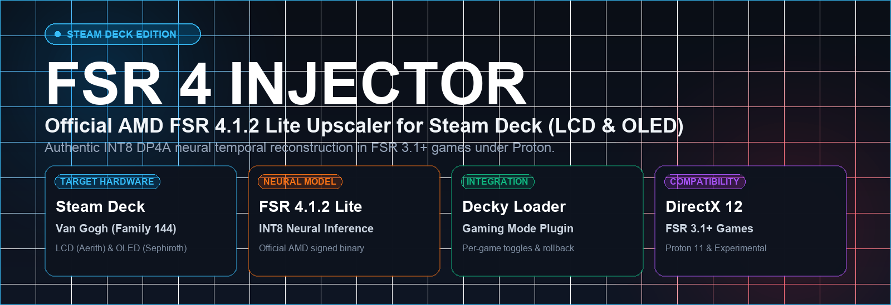

[-0969DA?style=for-the-badge&labelColor=141417)](#requirements)

**Steam Deck (Van Gogh / RDNA 2) FSR 4.1.2 Variant Manager for SteamOS Gaming Mode.**

Switch per game between **`zgauthier2000/fsr4-shader-performance-overrides`** (Cyboman's optimized RDNA 2 builds) and **AMD's official unmodified FSR 4.1.2 Lite** baseline directly from the Decky Quick Access Menu—with SHA-256 verified backups, clean rollback, and SteamOS RADV guardrails.

[Dual Backends](#dual-backends) · [Steam Deck Expectations](#steam-deck-expectations--800p-timings) · [Requirements](#requirements) · [Installation](#installation) · [Rollback](#clean-rollback) · [Credits & License](#credits--upstream)

---

## Dual Backends

1. **Cyboman RDNA 2 Overrides (Primary for Steam Deck — OptiScaler / FSR 4.1.1):**
   - Fetches `fsr4.1.2-igpu-cyboman-rdna2-*` from GitHub Releases (`zgauthier2000/fsr4-shader-performance-overrides`), using `.7z` (~9 MB) when `7zz`/`7z`/`bsdtar` is present and automatically falling back to `.zip` (~100 MB) via Python `zipfile`.
   - Extracts and caches only the two Steam Deck Lite RDNA 2 variants for `amd_fidelityfx_upscaler_dx12.dll` (saving ~50 MB of Deck storage):
     - **`4.1.2 Lite — Exact` (`4.1.2l-exact`) *(Recommended)*:** FSR 4.1.2 Lite, bit-exact to AMD Lite (~11–16% faster on RDNA 2).
     - **`4.1.2 Lite — Lossy` (`4.1.2l-lossy`):** FSR 4.1.2 Lite with alternating-frame neural pass (~13–22% faster, ~2.1 ms @ 800p; trades some frame pacing & exposure/speckle accuracy).
   - *Full desktop FSR 4.1.2 (`exact` / `lossy`) is intentionally omitted on Steam Deck due to Van Gogh's 8-CU / 15W frame-time budget.*
   - Verifies PE `FileVersion` (`4.1.1.2740` expected), backs up the original DLL to `amd_fidelityfx_upscaler_dx12.dll.fsr4deck.orig` with SHA-256 tracking, and uses same-filesystem hard links to avoid wasting Deck SSD space.

2. **Official AMD Lite (Baseline / Fallback — No OptiScaler Required):**
   - Retains the unmodified `amdxcffx64.dll` (~43 MB from `drivers.amd.com`) + open-source `amdxc64.dll` shim (`WINEDLLOVERRIDES=amdxc64=n,b`) for native DX12 FSR 3.1+ games.
   - Switching a game between `Off`, any `Cyboman RDNA 2` variant, and `Official AMD Lite` automatically rolls back the previous backend first.

> [!CAUTION]
> **Single-player / offline games only for Cyboman variants.** Cyboman DLLs are **modified binaries**. Anti-cheat software can treat replaced upscaler DLLs as tampering and ban your account. Anti-cheat and online multiplayer titles are explicitly flagged and excluded from bulk actions.

---

## Steam Deck Expectations & 800p Timings

- **Hardware budget:** Steam Deck LCD (`0x163F`, Aerith) & OLED (`0x1435`, Sephiroth) share an 8-CU RDNA 2 Van Gogh APU under a 15W SoC envelope, executing INT8 FSR 4 inference via `v_dot4_i32_i8` (DP4A).
- **Target frame rates:** Aim for **30 FPS** (Quality/Balanced) or **40–45 FPS** (Balanced/Performance) depending on the game's base GPU load.
- **800p shader pass timings:**
  - `4.1.2l-exact` trims FSR 4 Lite pass overhead (~11–16% faster than stock AMD Lite on RDNA 2) with zero visual difference.
  - `4.1.2l-lossy` lowers the upscaling pass to **~2.1 ms at 800p** (~13–22% faster) by running the neural network every second frame and motion-reprojecting in between. If you notice subtle frame-pacing variance at 30 FPS or minor speckling, switch that game back to `4.1.2l-exact`.
- **Avoid `RADV_PERFTEST=cswave32`:** On SteamOS RADV, forcing `cswave32` adds **~1.1 ms** overhead to FSR 4 compute passes. The plugin detects `RADV_PERFTEST=cswave32` in game launch options and displays a warning badge.
- **Watermark verification:** Toggle **Show FSR4 watermark** in Launch options:
  - Cyboman games receive `env MLSR-WATERMARK=1` (wrapped with `env` because hyphens fail in `/bin/sh`) to show strings like `4.1.2l-lossy-igpu-r2-cyboman`.
  - Official AMD Lite games receive `FSR_WATERMARK=1`.

---

## Requirements

| Requirement | Details |
|---|---|
| **Hardware** | Steam Deck LCD (`0x163F`) or Steam Deck OLED (`0x1435`) |
| **OS / Loader** | SteamOS Gaming Mode with [Decky Loader](https://decky.xyz) |
| **For Cyboman RDNA 2** | Game configured with **OptiScaler** or modular FidelityFX SDK 2.x providing `amd_fidelityfx_upscaler_dx12.dll` (typically `4.1.1.2740`) |
| **For Official AMD Lite** | DirectX 12 game with native `amd_fidelityfx_dx12.dll`, `amd_fidelityfx_upscaler_dx12.dll`, or `amd_fidelityfx_loader_dx12.dll` (FSR 3.1+) |

---

## Installation

1. Download `FSR4Injector-<version>.zip` from [Releases](https://github.com/XenoSlug/FSR4Injector-Deck/releases).
2. In Decky Loader: **Settings → General → Developer mode**, then **Developer → Install Plugin from ZIP**.
3. Open **FSR4 Injector** in the Quick Access Menu, download **Cyboman RDNA 2** (and optionally **Official AMD Lite**), and select a variant per game.

*Note: Existing v1.x installs upgrade in-place cleanly; configured Official AMD Lite games remain tracked and can be toggled off or switched to Cyboman variants at any time.*

---

## Clean Rollback

- Set a game back to **Off (Original)** (or tap **Turn off FSR4 and restore all games** before uninstalling):
  - **Cyboman games:** Verifies that the active `amd_fidelityfx_upscaler_dx12.dll` SHA-256 matches the variant we installed, restores `amd_fidelityfx_upscaler_dx12.dll.fsr4deck.orig` atomically, verifies the restored hash, and removes `env MLSR-WATERMARK=1`. Unrecognized or externally modified DLLs are never deleted or overwritten.
  - **Official AMD Lite games:** Removes our `amdxc64.dll`, `amdxcffx64.dll`, `fsr4injector.gpu`, and `WINEDLLOVERRIDES=amdxc64=n,b` / `FSR_WATERMARK=1` cleanly.

---

## Credits & Upstream

- [Rayekkk/FSR4Injector](https://github.com/Rayekkk/FSR4Injector) — Upstream Decky plugin architecture, LZMA2 streaming recipe, safety guarantees, and `amdxc64` shim.
- [zgauthier2000/fsr4-shader-performance-overrides](https://github.com/zgauthier2000/fsr4-shader-performance-overrides) — Cyboman's RDNA 2 / Steam Deck shader performance override builds (`4.1.2l-exact`, `4.1.2l-lossy`).
- **Etaash Mathamsetty** & [GE-Proton](https://github.com/GloriousEggroll/proton-ge-custom) — Original `amdxc64` D3D12 extension implementation.
- [vkd3d-proton](https://github.com/HansKristian-Work/vkd3d-proton) & [Decky Loader](https://github.com/SteamDeckHomebrew/decky-loader).

---

## License

- Plugin code: [BSD 3-Clause](LICENSE).
- Driver shim (`bin/amdxc64.dll` & `shim/`): [LGPL-2.1 or later](shim/COPYING.LIB).
- **Third-party binaries are never bundled:** Downloaded Cyboman builds are governed by `zgauthier2000/fsr4-shader-performance-overrides`'s **GPL-2.0** license. Optional Official AMD Lite downloads are subject to **AMD's Software EULA**. Not affiliated with AMD or Valve.
